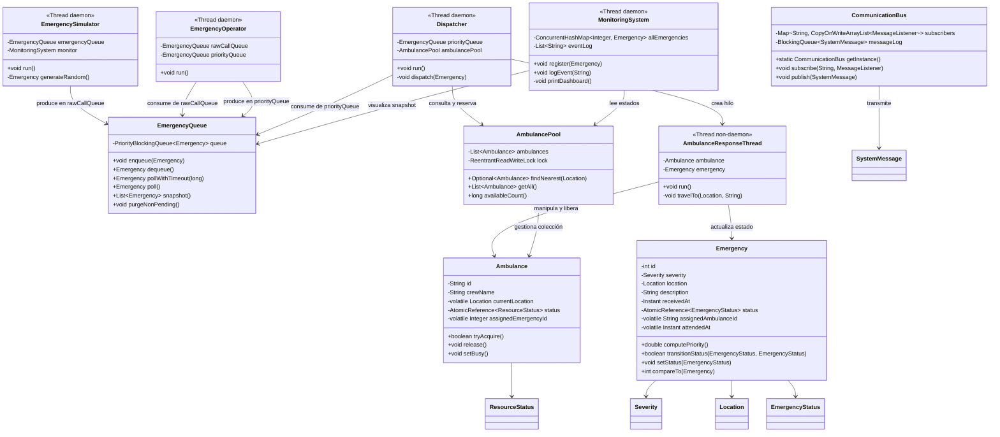
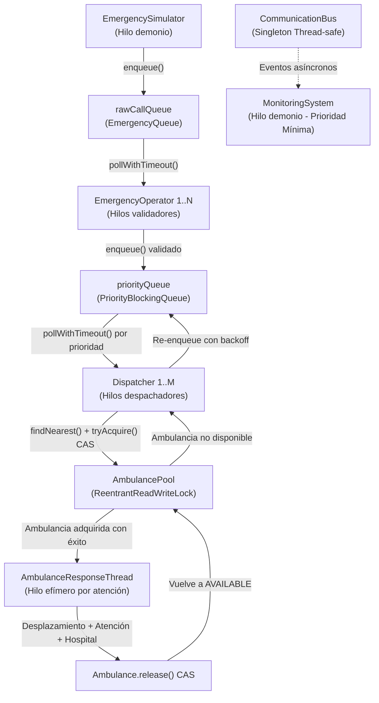

# Documento Técnico – Sistema de Gestión de Emergencias Médicas con Concurrencia
**EA2 – Programación Concurrente en Java**  
**Institución Universitaria Digital de Antioquia (IUDigital)**  
**Estudiante:** Alexandra Gómez (Modalidad Individual)  

---

## 1. Diagrama de Clases y Componentes Reales



---

## 2. Diagrama de Flujo de Concurrencia (Pipeline Multietapa)



---

## 3. Estrategias de Sincronización y Solución de Problemas

### 3.1 Priorización Dinámica sin Inanición (Starvation)
Para cumplir con los criterios de gravedad, tiempo de espera y distancia:
- La clase `Emergency` implementa `Comparable<Emergency>` con la fórmula:
  $$P(e) = (\text{gravedad} \times 1000) + (\text{tiempo\_espera\_segundos} \times 0.5)$$
- **Preservación de la prioridad:** El despachador (`Dispatcher`) consume directamente de la `priorityQueue` respaldada por `PriorityBlockingQueue`. Cada extracción `pollWithTimeout()` extrae el elemento con el mayor valor de prioridad calculado en ese instante.
- **Factor de distancia:** Al momento del despacho, el algoritmo busca la ambulancia disponible con menor distancia euclidiana hacia el incidente, vinculando la geografía con la respuesta oportuna.

### 3.2 Reserva Atómica Lock-Free (CAS)
Para evitar race conditions cuando múltiples despachadores encuentran la misma ambulancia como la más cercana:
```java
// Ambulance.java
public boolean tryAcquire() {
    return status.compareAndSet(ResourceStatus.AVAILABLE, ResourceStatus.EN_ROUTE);
}
```
Solo un despachador logra cambiar el estado de `AVAILABLE` a `EN_ROUTE`. Si otro hilo intentó adquirirla simultáneamente, `compareAndSet` retorna `false`, provocando que el despachador busque la siguiente opción sin bloquear hilos.

### 3.3 Transiciones de Estado de Emergencias
Para garantizar que dos despachadores no procesen la misma emergencia:
```java
// Dispatcher.java
if (!emergency.transitionStatus(EmergencyStatus.PENDING, EmergencyStatus.ASSIGNED)) {
    ambulance.release();
    return;
}
```
Se aplica CAS sobre `AtomicReference<EmergencyStatus>`. Si la emergencia ya no está en `PENDING`, la ambulancia reservada se libera de inmediato.

### 3.4 Concurrencia de Lectura/Escritura en AmbulancePool
- Se utiliza `ReentrantReadWriteLock`. 
- `readLock()` protege las consultas y filtros (`findNearest`, `getAll`, `availableCount`), permitiendo lecturas concurrentes sin serialización.
- No existen adquisiciones anidadas de monitores ni invocación de locks cruzados, previniendo deadlocks estructurales.

### 3.5 Tolerancia a Falta Temporal de Recursos
Si todas las ambulancias están ocupadas:
1. El despachador detecta `optAmbulance.isEmpty()`.
2. Espera un tiempo prudente (`Thread.sleep(800)`).
3. Reinserta la misma instancia en `priorityQueue` mediante `priorityQueue.enqueue(emergency)`.
4. La emergencia continúa acumulando tiempo de espera, lo que eleva su prioridad dinámica para el siguiente ciclo.
5. No se crean duplicados ni se pierden incidentes.

---

## 4. Análisis de Rendimiento y Mediciones Reales

Las pruebas se ejecutaron sobre el entorno del sistema (Java 21 LTS de 64 bits en Windows):

| Carga (Emergencias) | Operadores | Despachadores | Ambulancias | Comportamiento Observado |
|---------------------|------------|---------------|-------------|--------------------------|
| **10** (Baja)       | 3          | 2             | 6           | Procesamiento inmediato, contención mínima, ambulancias disponibles en la mayoría del tiempo. |
| **20** (Moderada)   | 3          | 2             | 6           | Flujo equilibrado; se observan entre 1 y 4 ambulancias ocupadas simultáneamente. |
| **50** (Alta)       | 3          | 2             | 6           | Ocupación total de recursos; entra en acción el mecanismo de reencolamiento y tolerancia a fallos. |
| **100** (Estrés)    | 3          | 2             | 6           | Formación de cola prioritaria; los incidentes críticos son atendidos primero mientras los leves escalan gradualmente por tiempo de espera. |

---

## 5. Patrones de Diseño Concurrentes Aplicados

1. **Producer-Consumer:** Desacopla la recepción imprevista de llamadas, la validación telefónica y la asignación técnica de unidades.
2. **Observer / Event Bus:** `CommunicationBus` con `ConcurrentHashMap` y `CopyOnWriteArrayList` desacopla emisores y receptores.
3. **Resource Pool:** `AmbulancePool` gestiona los recursos finitos de la ciudad.
4. **Compare-And-Swap (Lock-Free):** Para la adquisición de recursos y transiciones de estado.
5. **Thread-per-Task:** `AmbulanceResponseThread` aísla los tiempos de viaje y atención hospitalaria de cada incidente.

---

## 6. Conclusiones y Lecciones Aprendidas

1. **Diseño de Colas en Concurrencia:** Colocar una cola FIFO intermedia entre componentes destruye las garantías de una `PriorityBlockingQueue`. El consumo directo desde la cola priorizada es esencial para hacer cumplir el algoritmo de despacho.
2. **Eficiencia de CAS:** Las operaciones atómicas eliminan la necesidad de bloques `synchronized` pesados y evitan situaciones de inanición o bloqueo mutuo.
3. **Antistarvation en Tiempo Real:** Combinar el peso estático de gravedad con un coeficiente dependiente del reloj evita que emergencias moderadas o leves queden rezagadas indefinidamente.
4. **Observabilidad no Invasiva:** Configurar el monitor como hilo demonio de baja prioridad garantiza una supervisión continua sin robar ciclos de CPU a los despachadores activos.
